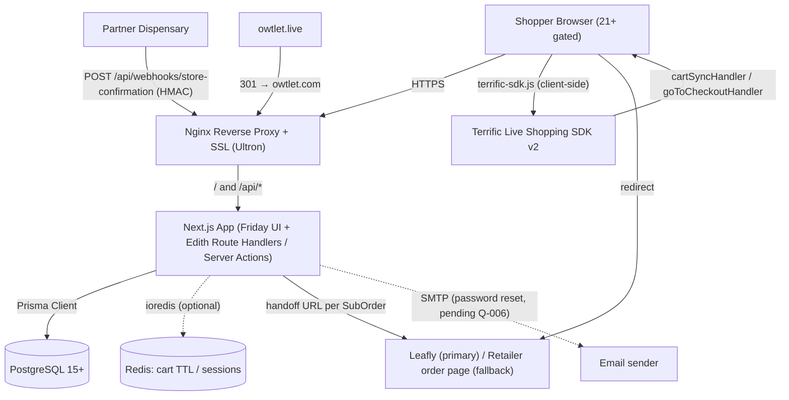

# 02 — System Architecture

> Maintained by `iron_man` and `edith`.

---

## 1. High-Level Architecture
Owtlet is a **single full-stack Next.js app** (UI + API routes) backed by PostgreSQL via Prisma, with two external integrations: Terrific (client-side live-shopping SDK) and the cannabis checkout handoff (Leafly primary / retailer order page fallback). The platform is **cannabis-only**; accessories / the `owtlet.shop` Shopify store are a separate project and out of scope. No mobile app.

---

## 2. Component Boundaries
- **Frontend Layer**: Next.js App Router (React Server & Client Components) — age gate, home/live, shoppable videos, catalog, brand storefronts, product, cart, checkout (pickup/delivery, store change, contact) & handoff, order status, shopper account, admin. Terrific embed is a client component that sets `window.terrificLiveSettings` **before** injecting the SDK script.
- **Mobile Layer (Optional)**: N/A — not in scope (responsive web only).
- **Backend Layer**: Next.js Route Handlers (`src/app/api/*`) + Server Actions, delegating to domain services in `src/server/<module>/` (products, pricing, brands, cart, orders, distribution, dispensaries, live-shows, age-session, shopper-account, checkout-handoff, admin). No NestJS.
- **Data Layer**: PostgreSQL 15+ managed via Prisma ORM (schema in `docs/07-database-design.md`).
- **Caching & Queue**: Redis **optional** — cart TTL & rate limiting; without Redis, cart expiry uses `Cart.expiresAt` + lazy cleanup.

---

## 3. Key Flows

### 3.1 Terrific add-to-cart (live / replay)
1. Viewer taps a pinned product in the Terrific player.
2. SDK calls `window.terrificLiveSettings.cartSyncConfig.cartSyncHandler({ action, cartProducts })` with `action ∈ addProductToCart | removeProductFromCart | updateProductInCart`.
3. Handler sends every pinned product (all cannabis) with `source` (`terrific_live` / `terrific_replay` / `terrific_video`) and `liveShowId` to `POST|PATCH|DELETE /api/cart/items` (Owtlet cart, PostgreSQL); the server maps `externalId` → `Product.terrificProductId` (fallback `sku`). Unmapped ids → `404 UNMAPPED_PRODUCT` + error toast.
4. Zustand cart store + TanStack Query cache refresh; `cart-change-notification` events keep the player badge in sync.

### 3.2 Checkout
1. SDK `goToCheckoutHandler({ cartProducts, coupons, redirectUrl })` (awaited) or the site cart button → `/checkout`.
2. Shopper picks Pickup or Delivery and a ZIP/address → `POST /api/orders/preview` runs the distribution service (eligibility by fulfillment type, delivery ZIP and brand channel → shopper overrides / default store → greedy "most items" → split) and returns sub-orders with store/delivery hours, distance, alternatives and out-of-stock suggestions.
3. Shopper (guest or signed in) enters contact info → `POST /api/orders` creates parent `Order` + `SubOrder`s (transaction), then `POST /api/checkout/handoff` returns a handoff URL per sub-order (Leafly or retailer page — provider pending client).
4. Dispensary confirms → `POST /api/webhooks/store-confirmation` → SubOrder `CONFIRMED` → parent status roll-up.

---

## 4. Integration Status
| Integration | Status | Notes |
|---|---|---|
| Terrific SDK v2 hooks | ✅ Verified (client-side, no plan/admin setting needed) | Standalone test page validated `cartSyncHandler`, `goToCheckoutHandler`, events |
| Leafly handoff | ⏳ Pending client (Q-001) | Implemented behind `HandoffProvider` interface |
| Retailer order pages / POS | ⏳ Pending client (Q-002) | Per-dispensary `handoffUrlTemplate` config |
| VPS + DNS | ⏳ Pending client (Q-003) | Docker + Nginx; `owtlet.com` + `owtlet.live` (301) |
| Transactional email (SMTP) | ⏳ Pending (Q-006) | Password reset for optional shopper profiles only |
