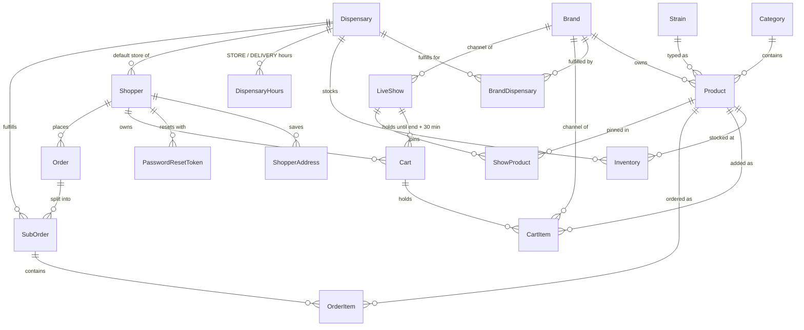

# 07 — Database Design & Prisma Schema

> Owned and maintained by `edith`.

---

## 1. Database Specifications
- **Database Engine**: PostgreSQL 15+
- **ORM**: Prisma ORM (schema at `development/frontend/prisma/schema.prisma`)
- **Migration Strategy**: Version-controlled SQL migrations (`prisma migrate dev` locally, `prisma migrate deploy` in the container on release)
- **Naming Conventions**: `snake_case` for database tables and columns; `camelCase` for Prisma fields.
- **Money**: `Decimal(10,2)` in USD. **Time zone**: store `timestamptz` (UTC); store hours evaluated in `America/New_York`.
- **Compliance**: No columns for government ID, DOB, or cannabis payment data — by design.
- **Scope**: Cannabis-only catalog (no product-kind split; accessories are out of scope).
- **Personal data**: only checkout contact info (name, email, phone, delivery address) and optional shopper profiles (argon2id password). Never DOB, government ID or payment data.

---

## 2. Core Entities & Schema Blueprint



```prisma
datasource db {
  provider = "postgresql"
  url      = env("DATABASE_URL")
}

generator client {
  provider = "prisma-client-js"
}

enum Role {
  SUPERADMIN
  ADMIN
}

enum StrainType {
  INDICA
  SATIVA
  HYBRID
  CBD
}

enum CartStatus {
  ACTIVE
  CHECKED_OUT
  EXPIRED
}

enum OrderStatus {
  PENDING // created, not yet handed off
  HANDED_OFF // at least one sub-order handed off
  PARTIALLY_CONFIRMED
  CONFIRMED // all sub-orders confirmed by stores
  CANCELLED
}

enum SubOrderStatus {
  PENDING
  HANDED_OFF
  CONFIRMED
  REJECTED
  CANCELLED
}

enum HandoffChannel {
  LEAFLY // primary — integration pending client (Q-001)
  RETAILER_PAGE // fallback — dispensary's own order page
}

enum ShowStatus {
  SCHEDULED
  LIVE
  REPLAY
  ARCHIVED
}

enum VideoFormat {
  LIVE_SHOW // live broadcast (becomes a replay when it ends)
  SHOPPABLE_VIDEO // short pre-recorded shoppable video (client Nov 11: "replays and shoppable video")
}

enum FulfillmentType {
  PICKUP // client Nov 11: "shoppers choose pickup or delivery"
  DELIVERY
}

enum HoursKind {
  STORE // in-store / pickup hours
  DELIVERY // client Nov 11: "each store sets its delivery ZIP codes and hours"
}

enum AssignmentSource {
  AUTO // greedy allocator (most items first)
  PROFILE_DEFAULT // shopper profile default store
  SHOPPER_CHANGED // shopper changed the store at checkout
}

model User {
  id           String   @id @default(uuid())
  email        String   @unique
  passwordHash String   @map("password_hash") // argon2id — Owtlet admins only (shoppers use Shopper)
  name         String?
  role         Role     @default(ADMIN)
  isActive     Boolean  @default(true) @map("is_active")
  createdAt    DateTime @default(now()) @map("created_at")
  updatedAt    DateTime @updatedAt @map("updated_at")

  @@map("users")
}

model Brand {
  id           String            @id @default(uuid())
  name         String
  slug         String            @unique // /brands/{slug} storefront (channel)
  description  String?
  logoUrl      String?           @map("logo_url")
  bannerUrl    String?           @map("banner_url")
  isActive     Boolean           @default(true) @map("is_active")
  sortOrder    Int               @default(0) @map("sort_order")
  createdAt    DateTime          @default(now()) @map("created_at")
  updatedAt    DateTime          @updatedAt @map("updated_at")
  products     Product[]
  dispensaries BrandDispensary[] // partner stores that fulfill this storefront
  liveShows    LiveShow[]
  cartItems    CartItem[]

  @@map("brands")
}

model BrandDispensary {
  brandId      String     @map("brand_id")
  dispensaryId String     @map("dispensary_id")
  createdAt    DateTime   @default(now()) @map("created_at")
  brand        Brand      @relation(fields: [brandId], references: [id], onDelete: Cascade)
  dispensary   Dispensary @relation(fields: [dispensaryId], references: [id], onDelete: Cascade)

  @@id([brandId, dispensaryId])
  @@index([dispensaryId])
  @@map("brand_dispensaries")
}

model Category {
  id        String    @id @default(uuid())
  name      String // Flower, Pre-Rolls, Vapes, Edibles, Concentrates (cannabis only)
  slug      String    @unique
  sortOrder Int       @default(0) @map("sort_order")
  products  Product[]

  @@map("categories")
}

model Strain {
  id       String     @id @default(uuid())
  name     String     @unique // e.g. "Blue Dream"
  type     StrainType
  products Product[]

  @@map("strains")
}

model Product {
  id                String   @id @default(uuid())
  name              String
  slug              String   @unique
  description       String?
  brandId           String?  @map("brand_id")
  categoryId        String   @map("category_id")
  strainId          String?  @map("strain_id")
  thcPercent        Decimal? @map("thc_percent") @db.Decimal(5, 2)
  cbdPercent        Decimal? @map("cbd_percent") @db.Decimal(5, 2)
  weightGrams       Decimal? @map("weight_grams") @db.Decimal(8, 2)
  imageUrls         String[] @map("image_urls")
  owtletPrice       Decimal? @map("owtlet_price") @db.Decimal(10, 2) // ONE price at every partner store; required for show products
  sku               String?  @unique
  terrificProductId String?  @unique @map("terrific_product_id") // id received in Terrific cartProducts
  shopifyLegacyId   String?  @map("shopify_legacy_id") // source id of migrated Shopify test product
  isActive          Boolean  @default(true) @map("is_active")
  createdAt         DateTime @default(now()) @map("created_at")
  updatedAt         DateTime @updatedAt @map("updated_at")

  brand        Brand?        @relation(fields: [brandId], references: [id])
  category     Category      @relation(fields: [categoryId], references: [id])
  strain       Strain?       @relation(fields: [strainId], references: [id])
  inventory    Inventory[]
  cartItems    CartItem[]
  orderItems   OrderItem[]
  showProducts ShowProduct[]

  @@index([categoryId])
  @@index([brandId])
  @@index([isActive])
  @@map("products")
}

model Dispensary {
  id                 String         @id @default(uuid())
  name               String
  slug               String         @unique
  licenseNumber      String?        @map("license_number") // NY OCM license (public info)
  addressLine1       String         @map("address_line1")
  city               String
  state              String         @default("NY")
  zip                String
  latitude           Decimal?       @db.Decimal(9, 6)
  longitude          Decimal?       @db.Decimal(9, 6)
  offersPickup       Boolean        @default(true) @map("offers_pickup")
  offersDelivery     Boolean        @default(true) @map("offers_delivery")
  coverageZips       String[]       @map("coverage_zips") // DELIVERY ZIPs this store serves (set per store)
  timezone           String         @default("America/New_York")
  handoffChannel     HandoffChannel @default(RETAILER_PAGE) @map("handoff_channel")
  handoffUrlTemplate String?        @map("handoff_url_template") // e.g. https://store.example/order?ref={subOrderId}
  leaflyStoreId      String?        @map("leafly_store_id") // pending Q-001
  webhookSecret      String         @map("webhook_secret") // HMAC for confirmation callbacks
  isActive           Boolean        @default(true) @map("is_active")
  createdAt          DateTime       @default(now()) @map("created_at")
  updatedAt          DateTime       @updatedAt @map("updated_at")

  hours              DispensaryHours[]
  inventory          Inventory[]
  subOrders          SubOrder[]
  brands             BrandDispensary[]
  defaultForShoppers Shopper[]         @relation("ShopperDefaultStore")

  @@index([zip])
  @@map("dispensaries")
}

model DispensaryHours {
  id           String     @id @default(uuid())
  dispensaryId String     @map("dispensary_id")
  kind         HoursKind  @default(STORE) // STORE (pickup) or DELIVERY hours
  dayOfWeek    Int        @map("day_of_week") // 0 = Sunday … 6 = Saturday
  opensAt      String     @map("opens_at") // "09:00" local time
  closesAt     String     @map("closes_at") // "22:00" local time (<= opensAt = past midnight)
  isClosed     Boolean    @default(false) @map("is_closed")
  dispensary   Dispensary @relation(fields: [dispensaryId], references: [id], onDelete: Cascade)

  @@unique([dispensaryId, kind, dayOfWeek])
  @@map("dispensary_hours")
}

model Inventory {
  id           String     @id @default(uuid())
  productId    String     @map("product_id")
  dispensaryId String     @map("dispensary_id")
  price        Decimal?   @db.Decimal(10, 2) // per-store price for NON-show products; ignored when Product.owtletPrice is set
  stockQty     Int        @default(0) @map("stock_qty")
  externalSku  String?    @map("external_sku") // dispensary/POS SKU (pending Q-002)
  updatedAt    DateTime   @updatedAt @map("updated_at")
  product      Product    @relation(fields: [productId], references: [id], onDelete: Cascade)
  dispensary   Dispensary @relation(fields: [dispensaryId], references: [id], onDelete: Cascade)

  @@unique([productId, dispensaryId])
  @@index([dispensaryId])
  @@map("inventory")
}

model Shopper {
  id                  String               @id @default(uuid())
  email               String               @unique
  passwordHash        String               @map("password_hash") // argon2id; optional profile — guest checkout needs none
  firstName           String?              @map("first_name")
  lastName            String?              @map("last_name")
  phone               String?
  homeZip             String?              @map("home_zip") // "location" (client Nov 11)
  defaultDispensaryId String?              @map("default_dispensary_id")
  createdAt           DateTime             @default(now()) @map("created_at")
  updatedAt           DateTime             @updatedAt @map("updated_at")
  defaultDispensary   Dispensary?          @relation("ShopperDefaultStore", fields: [defaultDispensaryId], references: [id], onDelete: SetNull)
  addresses           ShopperAddress[]
  carts               Cart[]
  orders              Order[]
  resetTokens         PasswordResetToken[]

  @@map("shoppers")
}

model ShopperAddress {
  id        String   @id @default(uuid())
  shopperId String   @map("shopper_id")
  label     String? // "Home", "Work"
  line1     String
  line2     String?
  city      String
  state     String   @default("NY")
  zip       String
  isDefault Boolean  @default(false) @map("is_default")
  createdAt DateTime @default(now()) @map("created_at")
  shopper   Shopper  @relation(fields: [shopperId], references: [id], onDelete: Cascade)

  @@index([shopperId])
  @@map("shopper_addresses")
}

model PasswordResetToken {
  id        String    @id @default(uuid())
  shopperId String    @map("shopper_id")
  tokenHash String    @unique @map("token_hash") // SHA-256 of the emailed token
  expiresAt DateTime  @map("expires_at") // 1 hour
  usedAt    DateTime? @map("used_at")
  shopper   Shopper   @relation(fields: [shopperId], references: [id], onDelete: Cascade)

  @@map("password_reset_tokens")
}

model Cart {
  id             String     @id @default(uuid())
  sessionToken   String     @unique @map("session_token") // value of owt_cart cookie
  shopperId      String?    @map("shopper_id") // set when a signed-in shopper owns the cart
  status         CartStatus @default(ACTIVE)
  zip            String?
  liveShowId     String?    @map("live_show_id") // show the cart is held for (last add from a LIVE show)
  lastActivityAt DateTime   @default(now()) @map("last_activity_at")
  expiresAt      DateTime   @map("expires_at") // materialised hold: see "Cart hold rules" below
  createdAt      DateTime   @default(now()) @map("created_at")
  updatedAt      DateTime   @updatedAt @map("updated_at")
  shopper        Shopper?   @relation(fields: [shopperId], references: [id], onDelete: SetNull)
  liveShow       LiveShow?  @relation(fields: [liveShowId], references: [id], onDelete: SetNull)
  items          CartItem[]
  order          Order?

  @@index([expiresAt])
  @@index([liveShowId])
  @@map("carts")
}

model CartItem {
  id                    String   @id @default(uuid())
  cartId                String   @map("cart_id")
  productId             String   @map("product_id")
  quantity              Int
  source                String   @default("catalog") // "catalog" | "brand_storefront" | "terrific_live" | "terrific_replay" | "terrific_video"
  channelBrandId        String?  @map("channel_brand_id") // added on a brand storefront → only that brand's stores at checkout
  liveShowId            String?  @map("live_show_id") // show/video it was added from (analytics + hold)
  preferredDispensaryId String?  @map("preferred_dispensary_id")
  createdAt             DateTime @default(now()) @map("created_at")
  cart                  Cart     @relation(fields: [cartId], references: [id], onDelete: Cascade)
  product               Product  @relation(fields: [productId], references: [id])
  channelBrand          Brand?   @relation(fields: [channelBrandId], references: [id], onDelete: SetNull)

  @@unique([cartId, productId, channelBrandId])
  @@map("cart_items")
}

model Order {
  id               String          @id @default(uuid())
  orderNumber      String          @unique @map("order_number") // e.g. OWT-100245
  cartId           String?         @unique @map("cart_id")
  shopperId        String?         @map("shopper_id") // null = guest checkout
  fulfillmentType  FulfillmentType @map("fulfillment_type")
  zip              String // delivery-address ZIP, or shopper location ZIP for pickup
  contactFirstName String          @map("contact_first_name") // "enter their info on owtlet.com" — no DOB, no ID
  contactLastName  String          @map("contact_last_name")
  contactEmail     String          @map("contact_email")
  contactPhone     String          @map("contact_phone")
  deliveryLine1    String?         @map("delivery_line1") // DELIVERY only
  deliveryLine2    String?         @map("delivery_line2")
  deliveryCity     String?         @map("delivery_city")
  deliveryState    String?         @map("delivery_state")
  status           OrderStatus     @default(PENDING)
  subtotal         Decimal         @db.Decimal(10, 2)
  createdAt        DateTime        @default(now()) @map("created_at")
  updatedAt        DateTime        @updatedAt @map("updated_at")
  cart             Cart?           @relation(fields: [cartId], references: [id])
  shopper          Shopper?        @relation(fields: [shopperId], references: [id], onDelete: SetNull)
  subOrders        SubOrder[]

  @@index([status])
  @@index([shopperId])
  @@map("orders")
}

model SubOrder {
  id              String           @id @default(uuid())
  orderId         String           @map("order_id")
  dispensaryId    String           @map("dispensary_id")
  fulfillmentType FulfillmentType  @map("fulfillment_type") // copied from Order
  assignment      AssignmentSource @default(AUTO)
  channelBrandId  String?          @map("channel_brand_id") // brand storefront the items came from (null = main site)
  status          SubOrderStatus   @default(PENDING)
  handoffChannel  HandoffChannel   @map("handoff_channel")
  handoffUrl      String?          @map("handoff_url")
  handedOffAt     DateTime?        @map("handed_off_at")
  confirmationRef String?          @map("confirmation_ref") // store's order number
  confirmationUrl String?          @map("confirmation_url") // link posted back by store
  confirmedAt     DateTime?        @map("confirmed_at")
  subtotal        Decimal          @db.Decimal(10, 2)
  createdAt       DateTime         @default(now()) @map("created_at")
  updatedAt       DateTime         @updatedAt @map("updated_at")
  order           Order            @relation(fields: [orderId], references: [id], onDelete: Cascade)
  dispensary      Dispensary       @relation(fields: [dispensaryId], references: [id])
  items           OrderItem[]

  @@index([orderId])
  @@index([dispensaryId, status])
  @@map("sub_orders")
}

model OrderItem {
  id         String   @id @default(uuid())
  subOrderId String   @map("sub_order_id")
  productId  String   @map("product_id")
  name       String // snapshot
  quantity   Int
  unitPrice  Decimal  @map("unit_price") @db.Decimal(10, 2) // snapshot of Product.owtletPrice ?? Inventory.price
  subOrder   SubOrder @relation(fields: [subOrderId], references: [id], onDelete: Cascade)
  product    Product  @relation(fields: [productId], references: [id])

  @@map("order_items")
}

model LiveShow {
  id             String        @id @default(uuid())
  title          String
  description    String?
  format         VideoFormat   @default(LIVE_SHOW)
  brandId        String?       @map("brand_id") // optional brand channel
  terrificShowId String?       @unique @map("terrific_show_id")
  embeddingId    String        @default("Cki70GhqvLgWGhJbSxg2") @map("embedding_id")
  status         ShowStatus    @default(SCHEDULED)
  scheduledAt    DateTime?     @map("scheduled_at")
  scheduledEndAt DateTime?     @map("scheduled_end_at") // fallback end time if admin doesn't press "End show"
  startedAt      DateTime?     @map("started_at")
  endedAt        DateTime?     @map("ended_at") // carts held until endedAt + 30 min
  thumbnailUrl   String?       @map("thumbnail_url")
  createdAt      DateTime      @default(now()) @map("created_at")
  updatedAt      DateTime      @updatedAt @map("updated_at")
  brand          Brand?        @relation(fields: [brandId], references: [id], onDelete: SetNull)
  products       ShowProduct[]
  heldCarts      Cart[]

  @@index([status, scheduledAt])
  @@map("live_shows")
}

model ShowProduct {
  showId    String   @map("show_id")
  productId String   @map("product_id") // product must have owtletPrice (one price at every store)
  sortOrder Int      @default(0) @map("sort_order")
  show      LiveShow @relation(fields: [showId], references: [id], onDelete: Cascade)
  product   Product  @relation(fields: [productId], references: [id], onDelete: Cascade)

  @@id([showId, productId])
  @@map("show_products")
}

model AgeVerificationSession {
  id          String   @id @default(uuid())
  sessionHash String   @unique @map("session_hash") // hash of owt_age cookie nonce — no DOB, no ID
  confirmed   Boolean // true = attested 21+, false = declined
  ipHash      String?  @map("ip_hash") // salted hash, for abuse rate-limiting only
  userAgent   String?  @map("user_agent")
  createdAt   DateTime @default(now()) @map("created_at")
  expiresAt   DateTime @map("expires_at")

  @@map("age_verification_sessions")
}

model CoverageZip {
  zip       String  @id
  region    String // MANHATTAN | QUEENS | BROOKLYN | WESTCHESTER | LONG_ISLAND
  latitude  Decimal @db.Decimal(9, 6)
  longitude Decimal @db.Decimal(9, 6)

  @@map("coverage_zips")
}
```

### 2.1 Business rules encoded by the schema (client answers, see `input/client-docs/`)
| Rule | Implementation | Client source |
|---|---|---|
| **One price for show products** | `unitPrice = Product.owtletPrice ?? Inventory.price`. A product can be pinned (`ShowProduct`) only if `owtletPrice` is set; then every store sells it at that price and the cart shows one price. Non-show products may keep per-store `Inventory.price` (client only fixed the price for show products; POS price feed later). Admin validation: product without `owtletPrice` needs `Inventory.price` on every stocked row. | Nov 9 "Same price at every partner store for show products, so the cart shows one price."; Nov 11 "Pricing: one Owtlet price for show products at every partner store." |
| **Brand storefront = channel** | `Brand` + `BrandDispensary`. `CartItem.channelBrandId` set when added on `/brands/{slug}`; at checkout that line may only be allocated to the brand's assigned stores. | Nov 9 "Each brand picks which of our partner dispensaries fulfill its storefront orders. Checkout on a brand storefront works the same as the main cart, but only shows that brand's chosen stores." |
| **Pickup or delivery** | `Order.fulfillmentType` (+ copy on `SubOrder`). DELIVERY candidates: `offersDelivery` and shopper ZIP ∈ `coverageZips`. PICKUP candidates: any active store with `offersPickup` (sorted by distance to the shopper ZIP). | Nov 11 "Pickup: yes, shoppers choose pickup or delivery."; "Only stores that deliver to the shopper's address appear." |
| **Delivery hours** | `DispensaryHours.kind = DELIVERY` rows (7 per store) next to `STORE` rows. | Nov 11 "each store sets its delivery ZIP codes and hours" |
| **Change store / default store** | `SubOrder.assignment` = `AUTO` / `PROFILE_DEFAULT` / `SHOPPER_CHANGED`; `Shopper.defaultDispensaryId`. | Nov 11 "Shoppers must be able to change the store at checkout… Shopper profiles should have a default partner store setting." |
| **Guest checkout + optional profile** | `Order.shopperId` nullable (guest); contact fields on `Order`; `Shopper`, `ShopperAddress`, `homeZip`. No DOB / ID / payment columns. | Nov 9 "Shoppers pick the store and enter their info on owtlet.com."; Nov 11 "Guest checkout with an optional profile (location, saved addresses, default store)" |
| **Cart held until show end + 30 min** | `Cart.liveShowId` + `LiveShow.endedAt` (see §2.2). | Nov 11 "Carts saved until 30 minutes after the show ends" |
| **Shoppable video** | `LiveShow.format = SHOPPABLE_VIDEO`; `CartItem.source = terrific_video`. | Nov 11 "Add-to-cart from replays and shoppable video, not just live shows" |

### 2.2 Cart hold rules (`server/cart/expiry.ts`)
1. Every cart change sets `lastActivityAt = now`.
2. Adding from a show whose `status = LIVE` sets `Cart.liveShowId`.
3. Effective expiry:
   - `liveShowId` set and the show is still LIVE (`endedAt` null) → **held** (never expires while the show runs); `expiresAt` is refreshed to `now + 30 min` on every read so the cleanup query skips it.
   - Show ended → `expiresAt = max(lastActivityAt + 30 min, endedAt + 30 min)`. Show end = admin "End show" (`endedAt`) or, if never pressed, `scheduledEndAt`.
   - No show link (catalog, brand storefront, replay, shoppable video) → `expiresAt = lastActivityAt + 30 min` (sliding inactivity — original plan; client only defined the live-show rule, see ADR-010).
4. Ending a show runs `UPDATE carts SET expires_at = GREATEST(last_activity_at, ended_at) + interval '30 min' WHERE live_show_id = $show AND status='ACTIVE'`.

> NULL note: `@@unique([cartId, productId, channelBrandId])` treats NULLs as distinct in PostgreSQL, so the cart service upserts main-site lines with `findFirst({ channelBrandId: null })` inside a transaction.

---

## 3. Query Optimization & Indexing Rules
- Index all foreign keys, unique constraint columns, and high-frequency filter columns.
- Use cursor-based pagination for large data sets (`take: limit, skip: 1, cursor: { id }`).
- GIN index on `dispensaries.coverage_zips` (raw migration: `CREATE INDEX ... USING GIN (coverage_zips)`) for `WHERE $zip = ANY(coverage_zips)`.
- Cart cleanup: `DELETE FROM carts WHERE status='ACTIVE' AND expires_at < now()` (cron/lazy on read), indexed by `expires_at`.
- Order creation (`Order` + `SubOrder` + `OrderItem`, cart → `CHECKED_OUT`) always runs in a single `prisma.$transaction`.
- Pickup candidate search: active stores with `offers_pickup`, ordered by haversine distance from the shopper ZIP centroid (small partner count → in-memory sort is fine).
- `ShowProduct` insert/update must check `products.owtlet_price IS NOT NULL` (service-level validation + admin UI).

---

## 4. Data Migration (Shopify test data → PostgreSQL)
- Source: ~22 cannabis products in Shopify store `f1jc7p-fs` (**test data only**).
- `prisma/seed-shopify-import.ts`: one-off Shopify product CSV export (provided by the owtlet.shop team) → map title/description/images/tags → `Product` (`shopifyLegacyId`), category/strain from tags, THC/CBD from metafields if present.
- Final production dataset pending client (Q-004). Accessories are **out of scope** (separate `owtlet.shop` project) — no accessory products or Shopify references exist in this database; `shopifyLegacyId` is only a migration trace for the test products.
